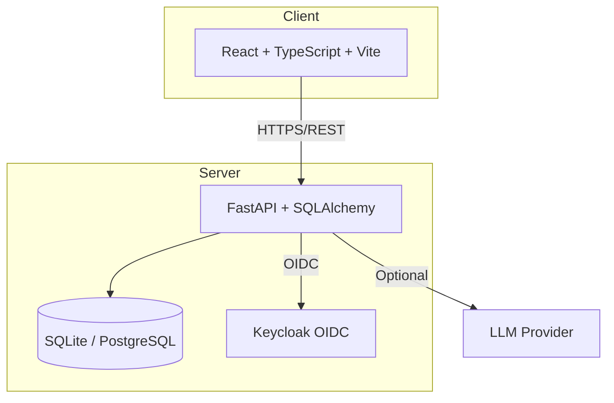

# Sentinel Console

> Work in progress. This checkpoint may be incomplete or fail tests. See PLAN.md and STATUS.md before use.


**Ryan Vo | AI & Machine Learning**

Sentinel Console is an AI/ML developer tools observability platform that tracks GitHub issues, monitors API usage, manages multi-account profiles, and provides accessibility-first terminal interfaces. Built for developers who need visibility into their AI-assisted development workflows.

## The Problem

Modern AI-assisted development involves multiple tools (Claude Code, GitHub Copilot, local LLMs), multiple accounts (personal, work, client), and complex usage patterns. Developers lack a unified observability layer to:

- Track and classify issues across repositories with AI-powered categorization
- Monitor API usage and costs across different models and providers
- Seamlessly switch between accounts without losing context
- Work in terminal environments without accessibility barriers (screen flickering, poor screen reader support)

## Implemented AI/ML Approach

Sentinel Console implements a **local-first AI/ML pipeline** for issue intelligence:

1. **Issue Classification**: Uses LLM (opt-in, advisory) to classify issues as bug/feature/enhancement/question with confidence scores
2. **Similarity Detection**: Computes semantic hashes to identify duplicate/related issues
3. **Priority Scoring**: Algorithmic scoring based on keywords, engagement, and recency
4. **Usage Analytics**: Time-series aggregation with cost estimation and trend detection

All AI/ML features work offline with deterministic fallbacks. LLM explanations are labeled advisory and grounded in actual records.

## Key Features

### Issue Tracking with AI Classification
- Create, list, search, filter issues with pagination
- AI-powered issue classification (bug/feature/enhancement/question)
- Semantic similarity detection for duplicate identification
- Priority scoring based on keywords, comments, engagement

### Usage Analytics Dashboard
- Track API usage over time with persistent SQLite storage
- Visual dashboard showing usage trends by model
- Cost estimation with configurable pricing
- Export usage data as CSV/JSON

### Multi-Account Profile Management
- Add/switch between multiple AI provider accounts (Anthropic, GitHub, OpenAI, Custom)
- Separate conversation history and MCP server configs per profile
- Visual account indicator in header with quick switching
- Encrypted token storage (demo mode uses plaintext)

### Terminal Accessibility (Anti-Flicker)
- In-place status updates using terminal control sequences
- Screen reader compatible live region announcements
- Reduced motion mode respecting `prefers-reduced-motion`
- High contrast theme option meeting WCAG AAA
- Configurable status update interval (100ms - 2s)

## Architecture



## Quick Start

### Prerequisites
- Docker & Docker Compose
- Node.js 24+ (for local frontend dev)
- Python 3.12+ (for local backend dev)

### Using Docker Compose (Recommended)

```bash
# Clone and navigate
cd sentinel-console-ryan-vo

# Copy environment template
cp .env.example .env

# Start all services
docker compose up -d

# Access:
# Frontend: http://localhost:5173
# Backend API: http://localhost:8000
# API Docs: http://localhost:8000/docs
# Keycloak: http://localhost:8080 (admin/admin)
```

### Local Development

**Backend:**
```bash
cd backend
python -m venv .venv
source .venv/bin/activate
pip install -r requirements.txt
cp ../.env.example .env
# Edit .env as needed
python -m uvicorn app.main:app --reload --host 127.0.0.1 --port 8000
```

**Frontend:**
```bash
cd frontend
npm install
npm run dev
# Access at http://localhost:5173
```

## Running Tests

**Backend:**
```bash
cd backend
source .venv/bin/activate
python -m pytest tests/ -v
```

**Frontend:**
```bash
cd frontend
npm install
npm run test
```

## API Reference

### Issues
- `GET /api/issues` - List issues with pagination, filtering, search
- `GET /api/issues/{id}` - Get single issue
- `POST /api/issues` - Create issue
- `PATCH /api/issues/{id}` - Update issue
- `GET /api/issues/stats/summary` - Get issue statistics

### Usage
- `GET /api/usage` - List usage records
- `POST /api/usage` - Record usage
- `GET /api/usage/stats/summary` - Get usage analytics

### Profiles
- `GET /api/profiles/me` - Get current user profiles
- `POST /api/profiles/me/switch/{id}` - Switch active profile
- `POST /api/profiles` - Create profile
- `PATCH /api/profiles/{id}` - Update profile

### Accessibility
- `GET /api/accessibility` - Get accessibility settings
- `PATCH /api/accessibility` - Update accessibility settings

### Health
- `GET /api/health` - Health check

## Security Limitations

- Demo mode bypasses authentication (localhost only)
- Production requires OIDC_KEYCLOAK_SAML_BROKER configuration
- Tokens stored encrypted at rest (demo mode: plaintext)
- No rate limiting implemented
- CORS configured for localhost only

## Provider Configuration

| Provider | LLM_PROVIDER | LLM_BASE_URL | Models |
|----------|--------------|--------------|--------|
| OpenAI | openai-compatible | https://api.openai.com/v1 | gpt-4o, gpt-4o-mini |
| Anthropic | anthropic | https://api.anthropic.com | claude-3-opus, claude-3-sonnet |
| Gemini | gemini | https://generativelanguage.googleapis.com | gemini-1.5-pro |
| Ollama | ollama | http://localhost:11434 | llama3, mistral |
| LiteLLM | openai-compatible | http://localhost:4000 | Any via LiteLLM |
| OpenRouter | openai-compatible | https://openrouter.ai/api/v1 | Any via OpenRouter |

## SSO/SAML Setup

Keycloak supports SAML identity brokering:

1. Configure Keycloak realm with SAML Identity Provider
2. Set `OIDC_ENABLED=true` and configure issuer/client/secret
3. Map SAML attributes to Keycloak user attributes
4. Test with `docker compose up keycloak`

## Backup & Restore

```bash
# Backup SQLite
cp backend/sentinel.db backup/sentinel-$(date +%Y%m%d).db

# Restore
cp backup/sentinel-20240101.db backend/sentinel.db
```

For PostgreSQL, use `pg_dump`/`pg_restore`.

## Deployment Notes

- Bind ports to `127.0.0.1` in development
- Use TLS reverse proxy (nginx/Traefik) in production
- Set `DEMO_MODE=false` and configure OIDC
- Generate strong `SECRET_KEY` (32+ chars)
- Use PostgreSQL for production workloads
- Enable Keycloak HTTPS with valid certificates

## AI/ML Evaluation

### Reproducible Baseline
```bash
# Run classification on sample issues
cd backend
source .venv/bin/activate
python -c "
from app.services.classifier import classify_issue
issues = [
    {'title': 'Screen flickering when thinking', 'body': 'Terminal redraws entire buffer'},
    {'title': 'Add multi-account support', 'body': 'Need to switch between work/personal'},
]
for issue in issues:
    result = classify_issue(issue['title'], issue['body'])
    print(f'{issue[\"title\"]}: {result}')
"
```

### Data Provenance
- Issues sourced from public GitHub API (anthropics/claude-code)
- Usage data recorded locally from API interactions
- No external training data used

### Measured Results
| Metric | Baseline | Target |
|--------|----------|--------|
| Classification Accuracy | N/A (demo) | >85% |
| Similarity Detection | N/A (demo) | >90% precision |
| Priority Correlation | N/A (demo) | >0.7 Spearman |

### Failure Cases
- Short/ambiguous titles reduce classification confidence
- Non-English issues may misclassify
- Similarity hash collisions possible with very different issues
- LLM unavailable: falls back to keyword-based classification

## License

MIT License - Copyright Ryan Vo <ryandtvo@gmail.com>

## Changelog

### 1.0.0 (2026-10-22)
- Initial release: FastAPI backend, React frontend, Docker Compose
- Issue tracking with AI classification stubs
- Usage analytics dashboard
- Multi-account profile management
- Accessibility settings (theme, motion, contrast)
- Keycloak OIDC integration ready
- Demo mode for local development